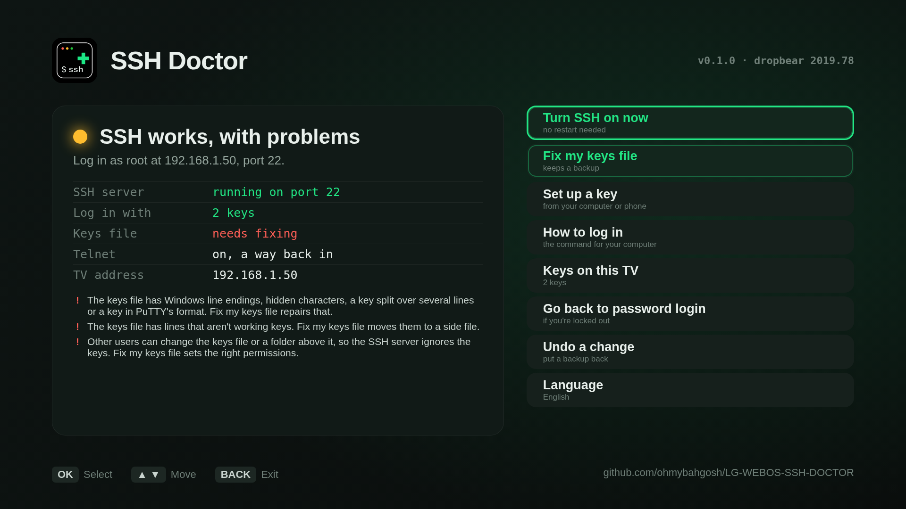
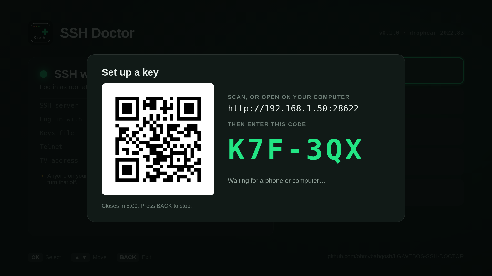
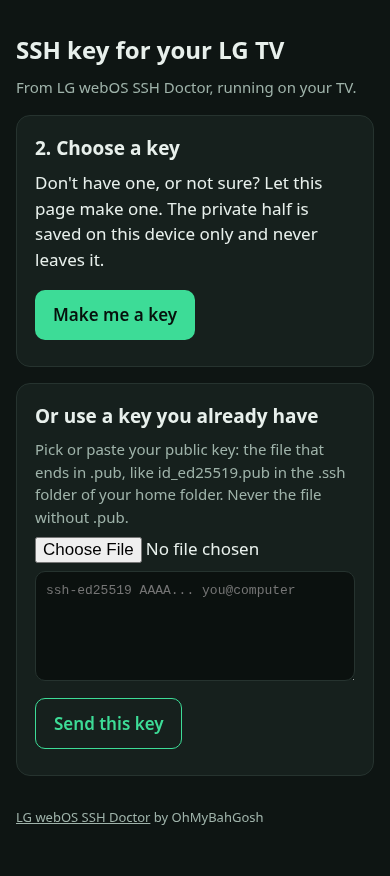

# LG webOS SSH Doctor: fix SSH on rooted LG TVs

**SSH on your rooted LG TV stopped working?  This app finds out why and fixes it from the TV itself, with just the remote.**  It also sets up an SSH key for your computer or phone with a short pairing code, so nobody has to copy keys around by hand.

> **Status: first version in testing.**  The app works, and its tests run on every change, but it hasn't been released yet.  Watch or star the repo to hear when it's in the Homebrew Channel.

It's a TV app for the [webOS Homebrew Channel](https://github.com/webosbrew/webos-homebrew-channel) on rooted LG webOS TVs ([RootMyTV](https://rootmy.tv), [faultmanager-autoroot](https://github.com/throwaway96/faultmanager-autoroot), crashd, DejaVuln and the rest).  It runs as root through the Homebrew Channel, not over SSH, so it still works when SSH is completely broken.

## Sound familiar?

- `ssh: connect to host 192.168.1.50 port 22: Connection refused`
- `Permission denied (publickey)` after adding a key, and now the `alpine` password doesn't work either
- PuTTY: `Network error: Connection refused` or `No supported authentication methods available`
- `WARNING: REMOTE HOST IDENTIFICATION HAS CHANGED!` after a reset
- `no matching host key type found` on a newer computer
- Dev Manager asks for a key and passphrase you never set up
- SSH was on in the Homebrew Channel, but nothing answers on port 22

These are the common ways SSH breaks on a rooted LG TV, and none of them needs a factory reset.

## What it will do

**Check.**  Opening the app shows, in plain words, everything that decides whether you can log in:

- whether SSH is turned on in the Homebrew Channel, and whether the SSH server (dropbear) is actually running and listening on port 22
- whether password login (`alpine`) is on, or keys only
- whether `/home/root/.ssh/authorized_keys` is usable: not empty, no Windows line endings or hidden characters, no private key pasted by mistake, no key wrapped across lines, with the right owner and permissions on the file and its folder
- whether telnet is on as a way back in, and whether the TV is in Homebrew Channel failsafe mode
- the TV's IP address, the exact command to log in with, and the TV's SSH key fingerprint, so a "host identification has changed" warning can be checked instead of guessed at



**Repair, one button each.**  Each says what it will change, keeps a dated backup, and can be undone with **Undo a change**:

- **Turn SSH on now,** without the reboot the Homebrew Channel toggle needs
- **Fix my keys file:** line endings, hidden characters, wrapped keys and permissions.  Bad lines are moved to a side file, never deleted
- **Go back to password login:** sets `authorized_keys` aside and turns the `alpine` password back on right away, for anyone locked out

**Set up a key with a pairing code:**

1. Choose **Set up a key** on the TV.  It shows a QR code, a web address on port 28622 (like `http://192.168.1.50:28622`), and a short code like `K7F-3QX`.
2. Scan the QR code or type the address on the computer or phone you'll log in from, and enter the code.
3. Upload the public key you already have, or let your browser make a new key pair.  The private key is saved on your device and never sent anywhere.  Only the public half goes to the TV.
4. Check that the fingerprint on the TV matches the one on the page, and press OK.  The page then shows the exact command for Mac, Linux, Windows or PuTTY, or how to add it to a phone app like Termius.

The pairing page only runs while that screen is open.  It closes after one key, after 5 minutes, or when the screen closes.  Five wrong codes get a new code, and three rounds of that close the page.  It only accepts public keys: a private key sent by mistake is refused.  Keys made in the browser use [TweetNaCl](https://tweetnacl.js.org) and the browser's own random numbers, and come out in OpenSSH's format, the same as `ssh-keygen -t ed25519`.

<p> </p>

## What it will never do

Touch system partitions, change the Homebrew Channel's own files, turn telnet off, or send your keys anywhere.  It warns before anything that would turn password login off, because adding the first key disables `alpine` at the next boot, and that catches a lot of people out.

## Over telnet

`ssh-doctor.sh` also works on its own, which helps when telnet is the only way in.  It's inside the app at `/media/developer/apps/usr/palm/applications/org.ohmybahgosh.sshdoctor/assets/ssh-doctor.sh`:

```sh
sh ssh-doctor.sh status        # what's wrong, in plain words
sh ssh-doctor.sh ssh-on        # turn SSH on and start it now
sh ssh-doctor.sh fix-keys      # repair authorized_keys and its permissions
sh ssh-doctor.sh password-on   # back to user root, password alpine
sh ssh-doctor.sh add-key FILE  # add one public key
sh ssh-doctor.sh keys          # the keys that can log in, with fingerprints
sh ssh-doctor.sh restore NAME  # put a backup back (see: sh ssh-doctor.sh backups)
```

## Languages

English, Russian and Spanish, following the TV's menu language, like [LG-USB-2-ETH0](https://github.com/ohmybahgosh/LG-USB-2-ETH0).

## Development

The script is POSIX `sh` for busybox; the TV app and pairing page are plain ES5 JavaScript for old webOS browsers.  Everything is tested without a TV:

```sh
sh tests/run.sh busybox          # the script against a fake TV (also dash and bash)
node tests/check-i18n.js         # every text translated
sh webos-app/build.sh            # the IPK (needs ares-package from @webos-tools/cli)
node tests/check-sshkey.js .cache/tweetnacl-1.0.3-nacl-fast.min.js   # browser-made keys work with ssh-keygen
node tests/ui-check.js           # TV screens and the pairing page in a browser (Playwright)
```

## More from OhMyBahGosh

- [LG-USB-2-ETH0](https://github.com/ohmybahgosh/LG-USB-2-ETH0): use a USB Ethernet adapter as the TV's wired port
- [ohmybahgosh.dev](https://ohmybahgosh.dev): all the webOS projects, and a Homebrew Channel repository to install them from

## License

MIT.  Not affiliated with LG Electronics.  LG and webOS are trademarks of their owners.
